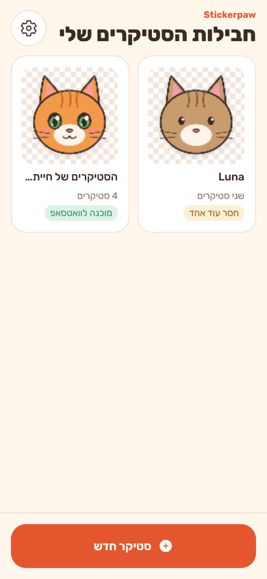
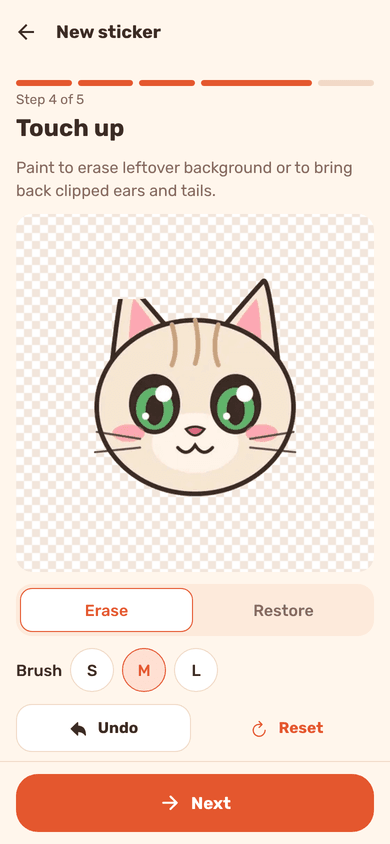
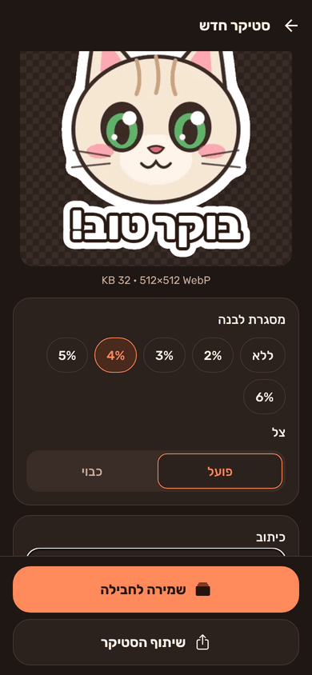
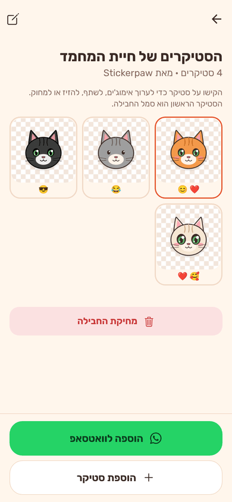
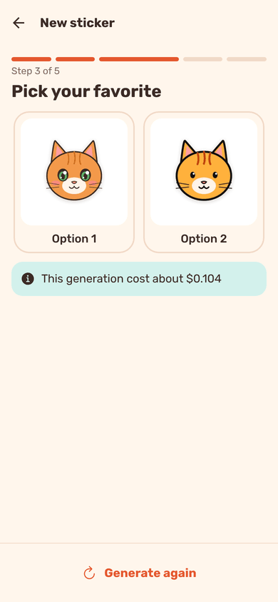
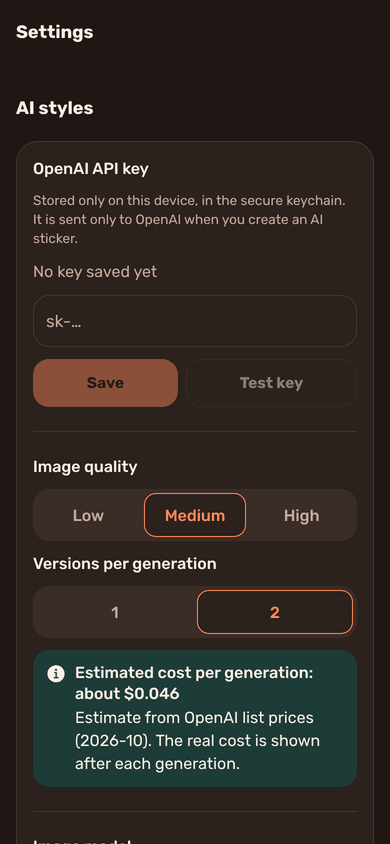

# Stickerpaw 🐾

A personal iOS + Android app that turns photos of your pet into **WhatsApp sticker packs**.
Pick a photo, choose a style (your real photo cut out, or an AI style: anime, cartoon, chibi,
3D, comic, watercolor, pixel art, pop art, clay/plush), touch up the cut-out, add a white
outline, a caption and an emoji, and add the pack to WhatsApp with one tap.

Hebrew is the default language (fully right-to-left); English is one tap away in Settings.

| Home | Touch-up | Finish | Pack | AI variants | Settings |
| --- | --- | --- | --- | --- | --- |
|  |  |  |  |  |  |

<sub>Screenshots are from the web preview (`npm run web`), which runs the same screens and
Skia code but uses a simple flood-fill instead of the on-device cut-out.</sub>

---

## How it works

1. **Photo** – gallery or camera, downscaled to 1024 px (expo-image-picker + expo-image-manipulator).
2. **Style** – *Classic* uses the real photo. Every other style sends the photo and a style
   prompt to OpenAI's Images API (`POST /v1/images/edits`), 1–2 variants, results cached.
3. **Cut-out on device** – always, even for AI images, so edges are consistent:
   iOS 17+ Vision `VNGenerateForegroundInstanceMaskRequest`, Android ML Kit Subject
   Segmentation (`modules/pet-cutout`). Then an erase/restore brush with undo.
4. **Finish** – crop to the subject, white outline (default 4 %), soft shadow, optional
   Hebrew/English caption (bold, dark stroke) and corner emoji, 1–3 WhatsApp emoji tags.
5. **Export** – exactly 512×512, transparent, 16 px margin, static WebP; quality is lowered
   until it is ≤ 100 KB. A 96×96 PNG tray icon is made from the first sticker.
6. **WhatsApp** – each pack has its own **Add to WhatsApp** button
   (`modules/whatsapp-stickers`): Android serves packs through a `ContentProvider` and fires
   `ENABLE_STICKER_PACK` (WhatsApp and WhatsApp Business); iOS uses the pasteboard +
   `whatsapp://stickerPack`, exactly like WhatsApp's official sample apps.
   **Share sticker** (PNG via the share sheet) is the fallback.

No accounts, no analytics, no backend. Everything stays on the phone.

---

## Run it on your own phone

You need **Node 20+** and this repo (`npm install` once). The app uses custom native code,
so it runs as a **development build** or a normal build — **not in Expo Go**.

### Android (easiest): build an APK with EAS and install it directly

```bash
npm install
npx eas-cli@latest login                 # free Expo account
npx eas-cli@latest init                  # links the project (writes the projectId into app.json)
npx eas-cli@latest build -p android --profile preview
```

The build runs in Expo's cloud (~10–15 min). When it finishes you get a link/QR code to the
`.apk`. Open it on your phone, allow "Install unknown apps" for your browser when asked, and
install. That's it — no Android Studio needed.

> `preview` builds a standalone APK (JS bundled inside). For day-to-day development use
> `--profile development` instead, then run `npm start` on your computer and open the app
> on the phone (same Wi-Fi); code changes reload instantly.

**Local alternative** (needs Android Studio + a USB-connected phone with USB debugging on):
`npx expo run:android --device` (add `--variant release` for a standalone build).

On first use the phone downloads Google's segmentation model through Google Play services.
If the first cut-out says "still downloading", wait a minute and try again.

### iPhone

Building for iPhone needs **a Mac with Xcode** (for local builds) and an **Apple ID**.
Background removal needs **iOS 17 or newer** and a real device (Vision's segmentation is not
reliable in the Simulator).

First, make the bundle identifier yours: in `app.json` change `expo.ios.bundleIdentifier`
(`com.stickerpaw.app`) to something unique, e.g. `com.yourname.stickerpaw`.

**Option A – free Apple ID (no paid account)**

1. Xcode → Settings → Accounts → add your Apple ID.
2. Connect the iPhone with a cable, unlock it, tap "Trust". On iOS 16+ also turn on
   Settings → Privacy & Security → **Developer Mode** (the phone restarts).
3. Run:
   ```bash
   npm install
   npx expo run:ios --device --configuration Release
   ```
   Pick your iPhone. If Xcode complains about signing, open `ios/Stickerpaw.xcworkspace`,
   select the *Stickerpaw* target → Signing & Capabilities → Team = your Personal Team, then
   run the command again.
4. On the phone: Settings → General → VPN & Device Management → trust your developer
   profile.

Limits of a free account: **the app stops opening after 7 days** — reconnect and run the
command again to re-sign it (your packs are kept). Max 3 sideloaded apps per device. EAS
cloud builds can't be signed with a free account.

**Option B – paid Apple Developer Program ($99/year)**

With a paid account you can build in the cloud with EAS (no 7-day expiry; ad-hoc builds stay
valid as long as the provisioning profile, typically a year):

```bash
npx eas-cli@latest login
npx eas-cli@latest init
npx eas-cli@latest device:create          # register your iPhone (opens a link on the phone)
npx eas-cli@latest build -p ios --profile preview
```

EAS creates the certificates and profile for you; install from the link it prints. Or ship
it to yourself via TestFlight: `eas build -p ios --profile production` then
`eas submit -p ios`. For development use `--profile development` and `npm start`.

### Adding a pack to WhatsApp

Make at least **3 stickers** in a pack (WhatsApp's minimum; max 30), open the pack and tap
**Add to WhatsApp**. Android asks which app if you have both WhatsApp and WhatsApp Business,
and shows "Added to WhatsApp" afterwards. iOS opens WhatsApp with the pack preview (iOS gives
apps no way to check whether a pack was added). Editing a pack later updates it in WhatsApp
automatically (`image_data_version` is bumped on every change).

---

## AI styles: your OpenAI key and cost

Paste your own key in **Settings → OpenAI API key** and tap **Test key**. The key is stored in
the iOS Keychain / Android Keystore (expo-secure-store) and is only ever sent to
`api.openai.com`.

- Model: `gpt-image-2.5-sunburst` by default (OpenAI's current default for image edits);
  changeable in Settings if OpenAI renames or retires it. Some GPT Image models require a
  [verified organization](https://platform.openai.com/settings/organization/general).
- Cost: Settings shows a per-generation estimate (≈ $0.03–0.13 depending on quality and
  1 or 2 variants). After each generation the app shows the real cost from the API's token
  usage. Results are cached, so going back and forth never charges twice.
- Errors are explained in plain language: missing/invalid key, rate limit, out of credit,
  content-policy refusal, model not available, timeouts.

> ### ⚠️ Before publishing to an app store
> This is a personal app: the API key is typed into and stored on the device. **Before
> distributing it to other people, move the AI calls behind a small server proxy** (e.g. a
> serverless function that holds the key and forwards `/v1/images/edits`), and point
> `OPENAI_BASE_URL` in `src/config/ai.ts` at it. Also: change the bundle id / package name,
> and read WhatsApp's note that Apple rejects apps that *only* export stickers.

---

## Development

```bash
npm install
npm run verify         # typecheck + lint + unit tests
npm run android        # = npx expo run:android (dev build on device/emulator)
npm run ios            # = npx expo run:ios (Mac only)
npm start              # Metro for an installed development build
npm run web            # quick UI preview in the browser (see notes below)
npm run assets         # regenerate icons, splash, style thumbnails, demo stickers
npm run prebuild       # regenerate ios/ and android/ from app.json + config plugins
```

- `ios/` and `android/` are generated (Continuous Native Generation) and git-ignored. Never
  edit them by hand — native code lives in `modules/*` and config in `app.json` plus the
  modules' `app.plugin.js` files.
- **Tests** (`npm test`) run the real Skia code on CanvasKit: export size/dimensions/alpha/
  margins, the quality loop, outline thickness, Hebrew captions, tray icon, touch-up, the
  WhatsApp validator against files from our own pipeline, contents.json/iOS payloads, the
  pack repository, i18n parity and the OpenAI provider with a mocked HTTP layer.
- **Live OpenAI test**: `cp .env.example .env`, fill in `OPENAI_API_KEY`, then
  `npm run test:openai-live` (one low-quality image, a few cents; the image is written to
  `artifacts/`).
- **On-device check**: Settings → Diagnostics → *Run pipeline self-test* cuts out the bundled
  test photo with the native module and checks every WhatsApp rule on the result.
- **Web preview** (`npm run web`, add `?demo=1&lang=en&theme=dark` to the URL for mock packs,
  language and theme): same screens, but in-memory storage, a flood-fill cut-out and no
  WhatsApp. It exists to iterate on UI quickly; the real targets are iOS and Android.

### Project layout

```
src/app/              Expo Router screens (Home, new-sticker wizard, pack, settings)
src/imaging/          Skia: compose (outline/shadow/caption), WebP export, tray, touch-up
src/ai/               StyleProvider interface, OpenAI provider, generation cache
src/config/styles.ts  Styles: names (he/en), thumbnails, prompts — add a style here
src/whatsapp/         Limits, contents.json/iOS payloads, validator, add-to-WhatsApp
src/state/            zustand stores, pack repository (db.json)
src/i18n/             en.ts / he.ts (typed, same keys), RTL handling
modules/pet-cutout/   Native background removal (Swift Vision / Kotlin ML Kit)
modules/whatsapp-stickers/  Android ContentProvider + intent, iOS pasteboard, config plugin
```

### Troubleshooting

- **"Background removal needs iOS 17"** – Vision's animal-capable segmentation is iOS 17+.
- **"Still downloading the cut-out model" (Android)** – Google Play services fetches ML Kit's
  model on first use; keep the phone online for a minute.
- **WhatsApp says there's a problem with the pack** – the app validates packs against
  WhatsApp's rules before handing them over; on Android, if WhatsApp still rejects a pack,
  its own validation message is shown on the pack screen.
- **Language switch** restarts the app — React Native applies the layout direction at start.

## Credits

- Pet test photo "Chelsea the cat" by Stefan van der Walt (CC0, from scikit-image).
- Rubik font by Hubert & Fischer (SIL Open Font License), via `@expo-google-fonts/rubik`.
- WhatsApp integration follows [WhatsApp/stickers](https://github.com/WhatsApp/stickers)
  (BSD); the Android ContentProvider is a Kotlin port of the sample's provider.
- All icons, illustrations and style thumbnails are generated from SVG by
  `scripts/generate-assets.mjs`.
